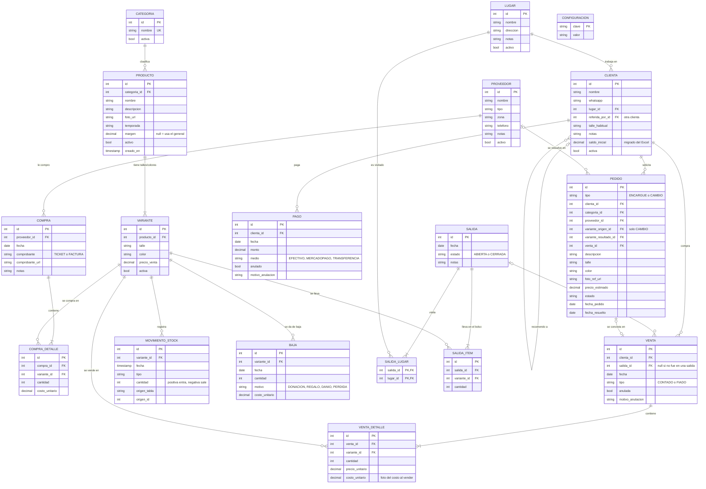

# Modelo de Datos — Sistema de Gestión "VV"

| Campo | Valor |
|---|---|
| Versión | 0.1 |
| Fecha | 06/11/2026 |
| Basado en | Documento de Requerimientos v1.0 |
| Motor | PostgreSQL |
| Pendiente | Ajustar la carga inicial cuando se analice el Excel |

---

## 1. Diagrama entidad-relación

> GitHub y VS Code (con la extensión de Mermaid) muestran este bloque como diagrama.



---

## 2. Diccionario de datos

Convenciones:
- Nombres en **español**, en `snake_case` y en singular.
- Toda tabla tiene `id` autoincremental como clave primaria, salvo las tablas intermedias.
- El dinero se guarda como `NUMERIC(12,2)`. **Nunca `FLOAT`**, porque los decimales binarios generan errores de redondeo.
- Las fechas de negocio son `DATE`. Los registros técnicos llevan `creado_en TIMESTAMPTZ DEFAULT now()` (se omite en las tablas de abajo para no repetir).
- **Nada se borra.** Los catálogos se desactivan (`activo = false`) y las operaciones se anulan (`anulada = true` + motivo).

### 2.1 Catálogo

**`categoria`**
| Columna | Tipo | Restricciones | Nota |
|---|---|---|---|
| id | SERIAL | PK | |
| nombre | VARCHAR(50) | NOT NULL, UNIQUE | Remera, jean, parka… |
| activa | BOOLEAN | DEFAULT true | |

**`producto`**: el modelo de prenda.
| Columna | Tipo | Restricciones | Nota |
|---|---|---|---|
| id | SERIAL | PK | |
| categoria_id | INT | FK → categoria, NOT NULL | |
| nombre | VARCHAR(100) | NOT NULL | "Rompeviento con capucha" |
| descripcion | TEXT | | |
| foto_url | VARCHAR(500) | | La foto se guarda en un storage externo, en la base solo va la URL. |
| temporada | VARCHAR(20) | | VERANO, INVIERNO, TODO_EL_ANIO |
| margen | NUMERIC(5,2) | CHECK ≥ 0 | Si es NULL, se usa el margen general (`configuracion`). RN-02 |
| activo | BOOLEAN | DEFAULT true | |

**`variante`**: talle + color. **Es la unidad del stock.**
| Columna | Tipo | Restricciones | Nota |
|---|---|---|---|
| id | SERIAL | PK | |
| producto_id | INT | FK → producto, NOT NULL | |
| talle | VARCHAR(10) | NOT NULL | S, M, 42, ÚNICO… |
| color | VARCHAR(30) | NOT NULL | |
| precio_venta | NUMERIC(12,2) | NOT NULL, CHECK ≥ 0 | Precio actual de lista. |
| activa | BOOLEAN | DEFAULT true | |
| | | UNIQUE (producto_id, talle, color) | No puede haber dos "M negra" del mismo producto. |

### 2.2 Compras

**`proveedor`**: id, nombre (NOT NULL), tipo (CENTRO_PRODUCTOR, NEGOCIO, EMPRENDEDOR), zona, direccion, telefono, notas, activo.

**`compra`**
| Columna | Tipo | Restricciones | Nota |
|---|---|---|---|
| id | SERIAL | PK | |
| proveedor_id | INT | FK → proveedor, NOT NULL | |
| fecha | DATE | NOT NULL | |
| comprobante | VARCHAR(10) | TICKET / FACTURA / NINGUNO | |
| comprobante_url | VARCHAR(500) | | Foto del ticket (RF-11). |
| notas | TEXT | | |

**`compra_detalle`**
| Columna | Tipo | Restricciones | Nota |
|---|---|---|---|
| id | SERIAL | PK | |
| compra_id | INT | FK → compra, NOT NULL | |
| variante_id | INT | FK → variante, NOT NULL | |
| cantidad | INT | NOT NULL, CHECK > 0 | |
| costo_unitario | NUMERIC(12,2) | NOT NULL, CHECK ≥ 0 | |

> El **total de la compra no se guarda**: se calcula sumando los detalles. Así nunca puede quedar desactualizado.

### 2.3 Clientas

**`lugar`**: id, nombre (NOT NULL, UNIQUE), direccion, notas, activo.

**`clienta`**
| Columna | Tipo | Restricciones | Nota |
|---|---|---|---|
| id | SERIAL | PK | |
| nombre | VARCHAR(100) | NOT NULL | |
| whatsapp | VARCHAR(20) | | En formato internacional: 54911… (para armar el link `wa.me`). |
| lugar_id | INT | FK → lugar | Puede no tener lugar (ej. una referida). |
| referida_por_id | INT | FK → clienta | **Relación de la tabla consigo misma (autorreferencia).** Así se modela el boca a boca. |
| talle_habitual | VARCHAR(10) | | |
| notas | TEXT | | Gustos, colores preferidos. |
| saldo_inicial | NUMERIC(12,2) | DEFAULT 0 | Deuda traída del Excel al migrar. Ver decisión D5. |
| activa | BOOLEAN | DEFAULT true | |

### 2.4 Ventas y cuenta corriente

**`venta`**
| Columna | Tipo | Restricciones | Nota |
|---|---|---|---|
| id | SERIAL | PK | |
| clienta_id | INT | FK → clienta, NOT NULL | |
| salida_id | INT | FK → salida | Si se vendió durante una salida. |
| fecha | DATE | NOT NULL | |
| tipo | VARCHAR(10) | CONTADO / FIADO | |
| anulada | BOOLEAN | DEFAULT false | RN-08 |
| motivo_anulacion | TEXT | | Obligatorio si anulada = true (CHECK). |

**`venta_detalle`**
| Columna | Tipo | Restricciones | Nota |
|---|---|---|---|
| id | SERIAL | PK | |
| venta_id | INT | FK → venta, NOT NULL | |
| variante_id | INT | FK → variante, NOT NULL | |
| cantidad | INT | NOT NULL, CHECK > 0 | |
| precio_unitario | NUMERIC(12,2) | NOT NULL | El precio **real** al que se vendió (puede diferir del de lista). |
| costo_unitario | NUMERIC(12,2) | NOT NULL | **Copia** del costo al momento de vender. RN-03 |

**`pago`**
| Columna | Tipo | Restricciones | Nota |
|---|---|---|---|
| id | SERIAL | PK | |
| clienta_id | INT | FK → clienta, NOT NULL | Se paga a la **cuenta**, no a una venta. RN-05 |
| fecha | DATE | NOT NULL | |
| monto | NUMERIC(12,2) | NOT NULL, CHECK > 0 | |
| medio | VARCHAR(15) | EFECTIVO / MERCADOPAGO / TRANSFERENCIA | |
| anulado | BOOLEAN | DEFAULT false | |
| motivo_anulacion | TEXT | | |

> Si una venta al contado se paga en el momento, se registran **la venta y un pago** en la misma transacción. Así todas las ventas siguen la misma lógica y el saldo queda en cero.

### 2.5 Stock

**`movimiento_stock`**: el "libro mayor" del stock. **Solo se insertan filas, nunca se modifican.**
| Columna | Tipo | Restricciones | Nota |
|---|---|---|---|
| id | SERIAL | PK | |
| variante_id | INT | FK → variante, NOT NULL | |
| fecha | TIMESTAMPTZ | NOT NULL | |
| tipo | VARCHAR(20) | ver lista | |
| cantidad | INT | NOT NULL, CHECK ≠ 0 | **Con signo**: + entra, − sale. |
| origen_tabla | VARCHAR(30) | | compra_detalle, venta_detalle, baja, pedido |
| origen_id | INT | | id de la fila que lo generó (trazabilidad). |

Tipos de movimiento:
| Tipo | Signo | Lo genera |
|---|---|---|
| STOCK_INICIAL | + | Carga inicial |
| COMPRA | + | compra_detalle |
| VENTA | − | venta_detalle |
| ANULACION_VENTA | + | Anular una venta (devuelve el stock) |
| CAMBIO_SALIDA | − | Pedido tipo CAMBIO: la prenda vuelve al proveedor |
| CAMBIO_ENTRADA | + | Pedido tipo CAMBIO: entra la prenda nueva |
| BAJA | − | baja |

**Stock de una variante = `SUM(cantidad)` de sus movimientos** (RN-01).

**`baja`**: id, variante_id, fecha, cantidad (> 0), motivo (DONACION / REGALO / DANIO / PERDIDA), costo_unitario (copia del costo, para medir la pérdida), nota.

### 2.6 Salidas de venta

**`salida`**: id, fecha, estado (ABIERTA / CERRADA), notas.

**`salida_lugar`**: los lugares visitados en esa salida. Clave primaria compuesta (salida_id, lugar_id).

**`salida_item`**: lo que llevaba en el bolso. id, salida_id, variante_id, cantidad. UNIQUE (salida_id, variante_id).

> No hace falta guardar el "resultado" de cada prenda. Lo vendido se sabe por las ventas con ese `salida_id`. Lo que "vuelve" es lo que se llevó menos lo vendido. Y "para cambio" es un `pedido`. **No guardes lo que podés calcular.**

### 2.7 Encargues y cambios

**`pedido`**: encargues y cambios comparten casi todo (clienta, estado, proveedor, seguimiento), así que van en una sola tabla con una columna `tipo`.
| Columna | Tipo | Nota |
|---|---|---|
| id | SERIAL PK | |
| tipo | VARCHAR(10) | ENCARGUE / CAMBIO |
| clienta_id | INT FK NOT NULL | |
| categoria_id | INT FK | Para el reporte de demanda insatisfecha. |
| proveedor_id | INT FK | Dónde se va a resolver (RF-37). |
| variante_origen_id | INT FK | Solo CAMBIO: la prenda que se devuelve. |
| variante_resultado_id | INT FK | La prenda conseguida, cuando se consigue. |
| venta_id | INT FK | La venta en la que se concretó. |
| descripcion, talle, color | | Lo que pidió la clienta. |
| foto_ref_url | VARCHAR(500) | La foto que mandó por WhatsApp. |
| precio_estimado | NUMERIC(12,2) | |
| estado | VARCHAR(15) | PENDIENTE, BUSCANDO, CONSEGUIDO, ENTREGADO, NO_CONSEGUIDO |
| fecha_pedido, fecha_resuelto | DATE | |

CHECK: si `tipo = 'CAMBIO'`, entonces `variante_origen_id` no puede ser NULL.

### 2.8 Configuración

**`configuracion`**: pares clave/valor.
| clave | valor inicial |
|---|---|
| margen_por_defecto | 25 |
| veces_para_estancada | 2 |
| dias_deuda_atrasada | 30 |

---

## 3. Decisiones de diseño

En los equipos esto se documenta como **ADR** (Architecture Decision Records). Si en una entrevista te preguntan "¿por qué lo hiciste así?", estas son tus respuestas.

**D1. El stock se calcula desde un libro de movimientos, no se guarda como un número.**
- *Alternativa descartada:* una columna `variante.stock` que se suma y se resta.
- *Por qué:* con la columna, si un bug resta dos veces, el número queda mal y no hay forma de saber por qué. Con el libro, cada unidad tiene su historia (RF-28), y el stock siempre puede recalcularse.
- *Costo:* hay que sumar filas para conocer el stock. Con este volumen (cientos de movimientos por año) es instantáneo. Si algún día crece, se agrega una vista materializada.

**D2. Variante separada de Producto.**
- La foto, la categoría y el proveedor son del modelo. El talle, el color y el stock son de cada unidad concreta. Si estuviera todo junto, habría que repetir la foto y el nombre en cada talle.

**D3. La venta copia el costo y el precio.**
- `venta_detalle.costo_unitario` y `precio_unitario` son una "foto" del momento. Si mañana cambia el precio de lista o compra más caro, la ganancia de las ventas viejas no cambia (RN-03). Esto **es desnormalización intencional**: se hace porque el dato histórico es distinto del dato actual.

**D4. Los pagos van a la cuenta de la clienta, no a una venta.**
- Así trabaja ella: le dan plata "a cuenta" (RN-05). La imputación FIFO para calcular la ganancia cobrada (RN-06) **no se guarda**: se calcula en el backend con una función con tests unitarios. Si más adelante se necesita, se puede agregar una tabla `pago_imputacion`.

**D5. La deuda que viene del Excel va en `clienta.saldo_inicial`.**
- No se sabe qué prendas ni a qué costo componen esa deuda, así que no se pueden crear ventas falsas sin inventar datos. La deuda se suma al saldo, pero no a los reportes de ganancia. *Se revisa al analizar el Excel.*

**D6. Encargues y cambios en una sola tabla (`pedido`).**
- Comparten el 90% de las columnas y el mismo ciclo de estados. Además, la vista "pendientes por proveedor" (RF-37) es una sola consulta.

**D7. Nada se borra.**
- Borrar una venta rompería el saldo, el stock y los reportes. Anular deja el rastro y genera un movimiento compensatorio (ANULACION_VENTA).

**D8. Las veces ofrecida se calculan, no se cuentan con un contador.**
- Cada combinación salida × lugar × prenda es una "vez ofrecida". Sale de un JOIN entre `salida_item` y `salida_lugar` (ver consulta 4.4).

**D9. Enums como `VARCHAR` + `CHECK`, no como tablas.**
- Medios de pago o motivos de baja son listas fijas que define el código. Si ella necesitara editarlas, pasarían a ser tablas (como `categoria`, que sí cambia).

---

## 4. Consultas clave

Si el modelo responde bien estas consultas, sirve. Así se valida un modelo **antes** de programar.

### 4.1 Stock por variante (RN-01)
```sql
CREATE VIEW v_stock AS
SELECT v.id AS variante_id, p.nombre, v.talle, v.color,
       COALESCE(SUM(m.cantidad), 0) AS stock
FROM variante v
JOIN producto p ON p.id = v.producto_id
LEFT JOIN movimiento_stock m ON m.variante_id = v.id
GROUP BY v.id, p.nombre, v.talle, v.color;
```

### 4.2 Saldo de cada clienta (RN-04)
```sql
SELECT c.id, c.nombre,
       c.saldo_inicial
     + COALESCE(vt.total, 0)
     - COALESCE(pg.total, 0) AS saldo
FROM clienta c
LEFT JOIN (
    SELECT v.clienta_id, SUM(d.cantidad * d.precio_unitario) AS total
    FROM venta v JOIN venta_detalle d ON d.venta_id = v.id
    WHERE NOT v.anulada
    GROUP BY v.clienta_id
) vt ON vt.clienta_id = c.id
LEFT JOIN (
    SELECT clienta_id, SUM(monto) AS total
    FROM pago WHERE NOT anulado
    GROUP BY clienta_id
) pg ON pg.clienta_id = c.id;
```
> Las ventas y los pagos se suman **en subconsultas separadas**. Si hacés un JOIN directo de clienta con venta y con pago, las filas se multiplican y los totales salen inflados. Es un error clásico en entrevistas técnicas.

### 4.3 Ganancia (devengada) del mes
```sql
SELECT SUM(d.cantidad * (d.precio_unitario - d.costo_unitario)) AS ganancia
FROM venta v JOIN venta_detalle d ON d.venta_id = v.id
WHERE NOT v.anulada
  AND v.fecha >= date_trunc('month', CURRENT_DATE);
```

### 4.4 Veces que se ofreció cada producto en cada lugar (RN-07)
```sql
SELECT p.id AS producto_id, p.nombre, sl.lugar_id,
       COUNT(DISTINCT s.id) AS veces_ofrecido
FROM salida s
JOIN salida_item si  ON si.salida_id = s.id
JOIN salida_lugar sl ON sl.salida_id = s.id
JOIN variante v      ON v.id = si.variante_id
JOIN producto p      ON p.id = v.producto_id
WHERE s.estado = 'CERRADA'
GROUP BY p.id, p.nombre, sl.lugar_id;
```
Con este resultado, el backend marca como **estancado** el producto que llegó a `veces_para_estancada` en todos los lugares activos sin haberse vendido, y como **en riesgo** el que llegó en la mitad o más.

### 4.5 Pendientes por proveedor (RF-37)
```sql
SELECT pr.nombre AS proveedor, pe.tipo, c.nombre AS clienta, pe.descripcion, pe.talle, pe.color
FROM pedido pe
JOIN clienta c ON c.id = pe.clienta_id
LEFT JOIN proveedor pr ON pr.id = pe.proveedor_id
WHERE pe.estado IN ('PENDIENTE', 'BUSCANDO')
ORDER BY pr.nombre, pe.fecha_pedido;
```

---

## 5. Prueba de escritorio

Recorrer un caso real por las tablas, a mano, para ver si el modelo aguanta.

1. **Compra.** El martes compra en "Taller Flores" una remera oversize: 1 talle M negra y 1 talle L blanca, a $10.000 cada una.
   → 1 `compra`, 2 `compra_detalle`, 2 `movimiento_stock` (COMPRA, +1 cada uno). El sistema sugiere $12.500 (25%).
2. **Salida.** El jueves arma el bolso con las dos remeras y va a CONICET.
   → 1 `salida` (ABIERTA), 1 `salida_lugar`, 2 `salida_item`.
3. **Venta fiada.** Marta se lleva la M negra en $12.500 y paga $5.000 por Mercado Pago.
   → 1 `venta` (FIADO, salida_id = la salida), 1 `venta_detalle` (precio 12.500, costo 10.000), 1 `movimiento_stock` (VENTA, −1), 1 `pago` ($5.000).
   → Saldo de Marta: $7.500. Ganancia devengada: $2.500. Stock M negra: 0.
4. **Cambio.** Ana quería la L blanca pero en talle M.
   → 1 `pedido` (CAMBIO, variante_origen = L blanca, proveedor = Taller Flores, PENDIENTE).
5. **Cierra la salida.** → `salida.estado = CERRADA`. La remera oversize suma 1 vez ofrecida en CONICET.
6. **Resuelve el cambio** en Taller Flores y se la entrega a Ana.
   → 2 `movimiento_stock` (CAMBIO_SALIDA −1 L blanca, CAMBIO_ENTRADA +1 M blanca), 1 `venta` para Ana, y el pedido pasa a ENTREGADO con su `venta_id`.

Cada paso se pudo registrar y cada número se puede reconstruir. ✅

---

## 6. Trazabilidad con los requerimientos

| Requerimiento | Tablas |
|---|---|
| RF-01 a RF-06 | categoria, producto, variante, proveedor |
| RF-07 a RF-11 | compra, compra_detalle, movimiento_stock |
| RF-12 a RF-16 | lugar, clienta |
| RF-17 a RF-24 | venta, venta_detalle, pago |
| RF-25 a RF-28 | movimiento_stock, baja |
| RF-29 a RF-32 | salida, salida_lugar, salida_item |
| RF-33 a RF-38 | pedido |
| RF-39 a RF-44 | consultas sobre las tablas anteriores (sin tablas propias) |
| RF-45 | clienta.saldo_inicial, movimiento_stock (STOCK_INICIAL) |
| RN-02, RN-07 | configuracion, producto.margen |

## 7. Historial de versiones
| Versión | Fecha | Cambios |
|---|---|---|
| 0.1 | 06/11/2026 | Primer modelo a partir de Requerimientos v1.0. |
